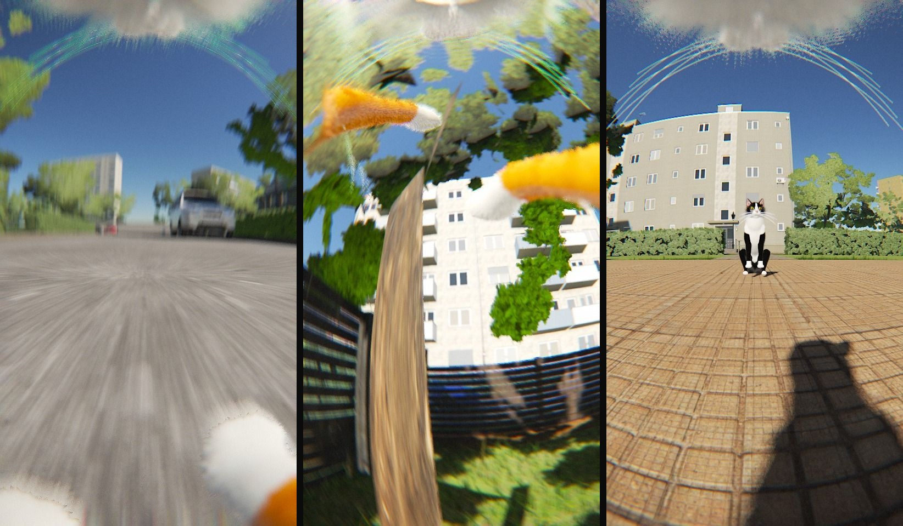

# Whiskercam

A day on the estate, filmed from under a cat's chin. A browser game.

**Play it:** https://flujo-app.github.io/whiskercam/



You are a cat with a small camera on your collar. The battery lasts three minutes. Whatever you
do in that time ends up in the clip, and the clip gets views:

- **Chase your brother.** Rocket is faster than you. Stay on his tail, and tag him when he looks back.
- **Win the turf.** Three cats guard the bins, the car port and the square. Walk up to one and it
  becomes a slap fight: slap when they are open, pull back when a paw comes up.
- **Make a mess.** Pots, cans, a gnome, a ball. A paw swipe sends them flying.
- **Go where cats go.** Under cars, through hedges, over walls.

When the battery dies the clip is "posted": you get its title, its views and the comments, and you
can save the clip as a real video file.

## Controls

| | Keyboard and mouse | Touch | Gamepad |
| --- | --- | --- | --- |
| Run | W (S to back up) | left thumb | left stick |
| Sprint | Shift | push the stick far | right trigger |
| Steer | mouse, or A / D | left thumb, or drag on the right | left stick, right stick |
| Jump | Space | Jump button | A |
| Paw swipe / slap | left and right mouse button, or Q / E | paw buttons | X / B |
| Pull back in a fight | S | Jump button | Y |
| Pause | Esc | | Start |

The picture is upright, like a phone clip, on every screen.

## How it is made

Everything is built by script. There is no hand-made 3D model in this repository.

1. Python scripts build the estate in Blender at real size, from free scanned surfaces and objects
   ([Poly Haven](https://polyhaven.com), public domain) plus shapes made by code: the houses, the
   cars, the cat.
2. Blender's film renderer works out the light once: sun, sky and bounced light for every surface.
   The estate is cut into slices so each job fits an ordinary 8 GB graphics card. The whole bake
   takes about 20 minutes on an RTX 2070 Super.
3. The game looks that light up while you play, and adds what a small action camera does to a
   picture: fisheye lens, motion streaks, automatic exposure, soft focus up close, lens flare, grain.

More detail: [docs/PIPELINE.md](docs/PIPELINE.md).

## Run it yourself

```text
npm install
npm run dev
```

The packed world is not in this repository (it is large and can be rebuilt). Either rebuild it
(see [docs/PIPELINE.md](docs/PIPELINE.md)) or copy the `assets` folder from the published site
into `public/`.

```text
npm test          logic tests (fights, scoring, paths)
npm run typecheck
node tools/playtest.mjs estate    a bot plays a whole round in a hidden browser
```

## Credits and licence

Code: MIT, see [LICENSE](LICENSE). Scanned surfaces, objects and sound recordings come from the
people listed in [CREDITS.md](CREDITS.md).
